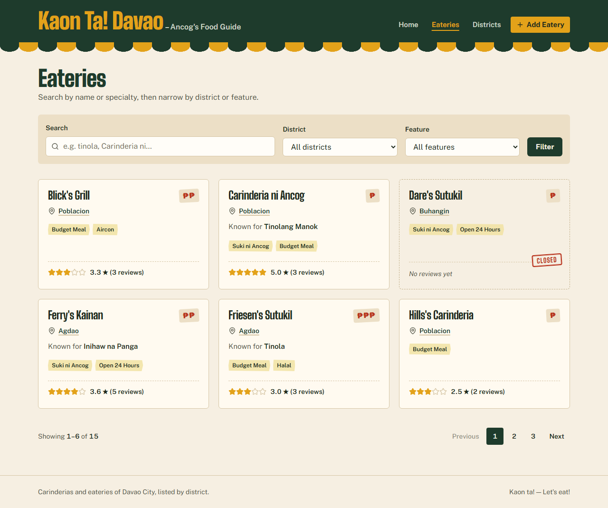
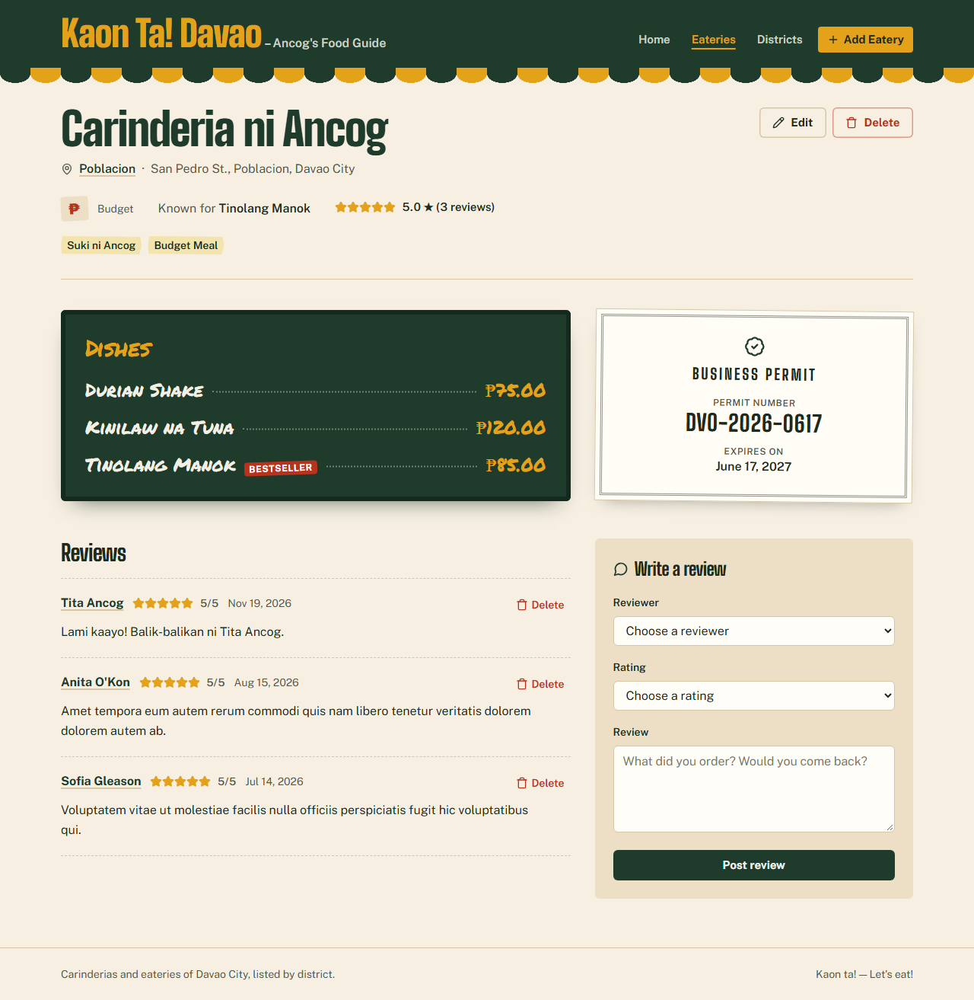
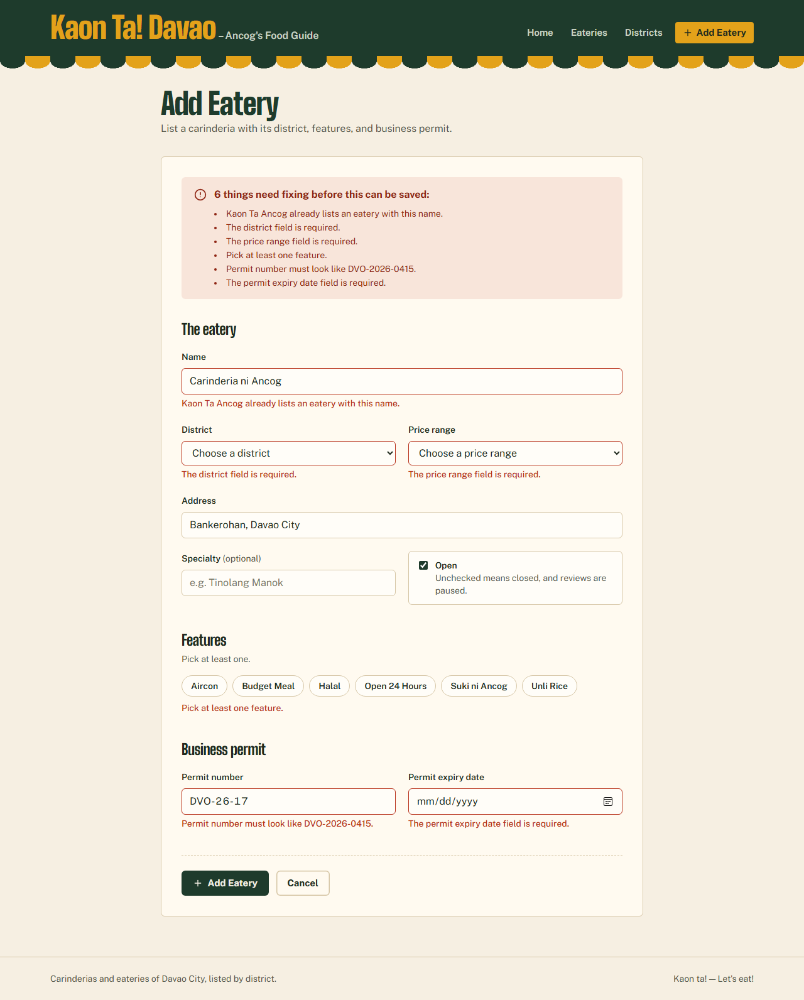

# Kaon Ta! Davao – Ancog's Food Guide

**Prefinal Milestone Project: Carinderia & Eatery Guide**
By **Greece Ancog** · 4-334 CS Elective 2 Full-Stack Development (Laravel) · Ateneo de Davao University · 1st Semester 2026

A Laravel 12 + SQLite guide to Davao City carinderias, listed by district. Each eatery has a business permit, dishes, features (Halal, Budget Meal, Open 24 Hours…), and reviews from residents. There is no login: every page is public, and the review form picks the reviewer from the seeded users.

## Setup

```bash
composer install
cp .env.example .env
php artisan key:generate
touch database/database.sqlite
php artisan migrate:fresh --seed
npm install
npm run build        # or npm run dev while developing
php artisan serve
```

Then open http://127.0.0.1:8000.

**On Windows PowerShell:** `touch` does not exist there. Create the empty SQLite file with this instead (the other commands work as written):

```powershell
New-Item -ItemType File database/database.sqlite
```

Or run the commands above in Git Bash, where `touch` works.

## My personalized data

| Item | Value |
|---|---|
| Site title | Kaon Ta! Davao – Ancog's Food Guide |
| Districts (6) | Poblacion, Talomo, Agdao, Buhangin, Toril, Tugbok |
| Features (6) | Suki ni Ancog, Budget Meal, Halal, Open 24 Hours, Aircon, Unli Rice |
| Users | Greece Ancog (`ancog@kaonta.test`) and Tita Ancog (`tita.ancog@kaonta.test`), password `kaonta2026`, plus 10 factory users |
| My eatery | **Carinderia ni Ancog** (`/eateries/carinderia-ni-ancog`), Poblacion, San Pedro St., Poblacion, Davao City · budget · specialty Tinolang Manok · open |
| Its features | Suki ni Ancog, Budget Meal |
| Its permit | **DVO-2026-0617**, expires June 17, 2027 |
| Its dishes | Tinolang Manok ₱85.00 (Bestseller), Kinilaw na Tuna ₱120.00, Durian Shake ₱75.00 |
| Its reviews | 3, including Tita Ancog's 5★ "Lami kaayo! Balik-balikan ni Tita Ancog." |

Seeded totals: 6 districts, 6 features, 12 users, 15 eateries (3 closed), 15 permits.

## Relationships

| Relationship | Type | Why this type fits |
|---|---|---|
| District → Eatery | `hasMany` / `belongsTo` | A district holds many eateries, but each eatery sits in exactly one district, so the eatery keeps `district_id`. |
| Eatery → Dish | `hasMany` / `belongsTo` | A carinderia serves many dishes, and each dish on its menu belongs to that one eatery. |
| Eatery → Review | `hasMany` / `belongsTo` | An eatery collects many reviews, and every review is about one eatery. |
| User → Review | `hasMany` / `belongsTo` | One person can write many reviews, but each review has a single author. |
| Eatery → Permit | `hasOne` / `belongsTo` | An eatery has only one business permit; `permits.eatery_id` is unique, which makes it one-to-one. |
| Eatery ↔ Feature | `belongsToMany` / `belongsToMany` (pivot `eatery_feature`) | An eatery can have several features and a feature like Halal applies to many eateries, so the links live in a pivot table. |
| District → Review (through Eatery) | `hasManyThrough` | Reviews don't store a district, but each review's eatery does, so the district reaches its reviews by going through its eateries. |

## Routes

Output of `php artisan route:list --except-vendor`:

```
  GET|HEAD        / ............................................................................ home › HomeController
  GET|HEAD        districts ............................................... districts.index › DistrictController@index
  GET|HEAD        districts/{district} ...................................... districts.show › DistrictController@show
  GET|HEAD        eateries ................................................... eateries.index › EateryController@index
  POST            eateries ................................................... eateries.store › EateryController@store
  GET|HEAD        eateries/create .......................................... eateries.create › EateryController@create
  GET|HEAD        eateries/{eatery} ............................................ eateries.show › EateryController@show
  PUT|PATCH       eateries/{eatery} ........................................ eateries.update › EateryController@update
  DELETE          eateries/{eatery} ...................................... eateries.destroy › EateryController@destroy
  GET|HEAD        eateries/{eatery}/edit ....................................... eateries.edit › EateryController@edit
  POST            eateries/{eatery}/reviews .......................... eateries.reviews.store › ReviewController@store
  GET|HEAD        reviewers/{user} .......................................... reviewers.show › ReviewerController@show
  DELETE          reviews/{review} ........................................ reviews.destroy › ReviewController@destroy

                                                                                                   Showing [13] routes
```

`{eatery}` binds by slug (e.g. `/eateries/carinderia-ni-ancog`); every other model binds by id.

## Screenshots

### Eatery list


### Eatery page with reviews


### Create form with validation errors

